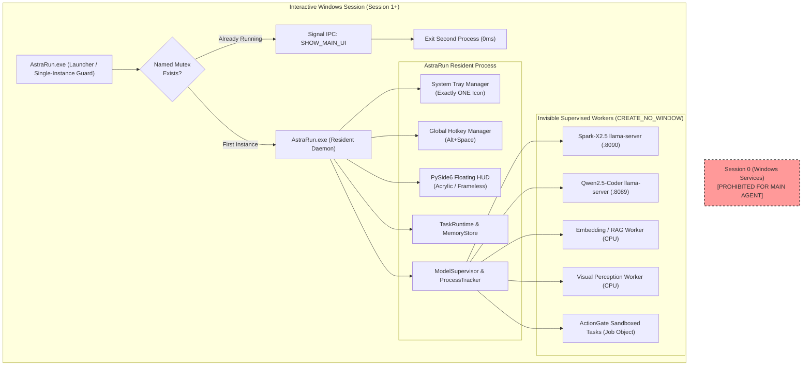

# 52 — AstraRun 1.0 Distribution & Resident-Application Specification

> **Status**: BINDING ARCHITECTURAL SPECIFICATION & PRODUCTIZATION CONTRACT  
> **Target Baseline**: AstraRun 1.0  
> **Applies to**: Milestone 3 through Milestone 8  
> **Date**: 2026-10-01  
> **Authority**: Platform Core Engineering  

---

## 1. Executive Summary & Design Invariant

AstraRun 1.0 is a **local-first Windows desktop agent** designed to run continuously and unobtrusively in the user's interactive Windows session. It behaves as a polished, standard Windows desktop application:

```text
Windows Login 
  └──> AstraRun starts automatically in background (no console window)
        └──> Exactly ONE icon appears in the Windows notification area / system tray
              └──> Alt+Space summons the floating interactive command HUD
                    └──> Closing / dismissing HUD returns AstraRun to background residency
```

Every subsystem developed from Milestone 3 onwards (Hybrid RAG, Memory, Skills, Perception, TaskRuntime, Packaging) **must remain strictly compatible** with this headless, resident, single-instance architecture.

---

## 2. Resident Application Architecture: Per-User Session Daemon



### 2.1 Why AstraRun is NOT a Session-0 Windows Service
AstraRun **must not** be implemented as a Windows Service (`Session 0`). In modern Windows architectures, Session 0 isolation prohibits:
1. System tray icons and notification area interactions.
2. Direct registration and reception of user global hotkeys (`RegisterHotKey`).
3. Interactive PySide6 acrylic / frameless desktop UI rendering.
4. Foreground window tracking (`GetForegroundWindow`, Windows shell hooks).
5. User desktop UI Automation (UIA) tree inspection and native Win32 accessibility hooks.
6. User clipboard read/write access.
7. Interactive browser automation within the user's active session.

Therefore, AstraRun runs as a **per-user resident daemon** within the active interactive desktop session. If administrative operations requiring elevated privileges are ever needed post-1.0, they will be delegated to an isolated, lightweight helper broker; the main agent remains in the user session.

---

## 3. Single-Instance Protection & Activation Protocol

1. **Named Mutex**: Upon startup, `AstraRun.exe` opens or creates a per-user named Win32 mutex (e.g. `Local\AstraRun_SingleInstance_<UserSID>`).
2. **Duplicate Detection**: If `GetLastError() == ERROR_ALREADY_EXISTS`:
   - The secondary process locates the primary instance via a local IPC mechanism (named pipe or Win32 `WM_COPYDATA` / custom registered window message).
   - Transmits message: `SHOW_MAIN_UI` (or `SHOW_TASK_CENTER`).
   - The secondary process terminates immediately (`exit(0)`).
3. **Start Menu & Shortcut Integration**: This mechanism guarantees that launching AstraRun from the Start Menu, desktop shortcut, or run dialog brings the existing resident agent to the foreground without spawning duplicate daemon trees.

---

## 4. System Tray (Notification Area) & State Contract

Milestone 5 will provide exactly **ONE** persistent icon in the Windows notification area.

### 4.1 Interaction Model
- **Left Click / Double Click**: Summons or focuses the main AstraRun Command HUD / Task Center.
- **Right Click Context Menu**:
  - `Open Astra` (Default bold action)
  - `Pause Astra` (Pauses ongoing background indexing / task execution)
  - `Settings` (Opens settings and preferences)
  - `---`
  - `Restart Astra` (Performs clean worker teardown and reloads resident engine)
  - `Quit Astra` (Terminates all supervised children, releases mutex, and exits)
- **Dismiss Invariant**: Closing, minimizing, or clicking away from the HUD dismisses the visible surface, returning AstraRun to background residency. The tray icon remains alive.

### 4.2 Single Tray Icon Contract
There is strictly **one** tray icon representing AstraRun. Child workers (`llama-server`, embedding workers, RAG indexers, vision workers) are strictly internal and must never register independent tray icons.

### 4.3 Tray State Machine
The single tray icon dynamically reflects platform health and activity:

| State | Visual Indicator | Meaning |
| :--- | :--- | :--- |
| `READY` | Stable Neutral / Accent Icon | Resident daemon idle, models warm, ready for `Alt+Space`. |
| `WORKING` | Subtle Pulse / Activity Badge | Actively executing a cognitive plan or background indexing. |
| `PAUSED` | Pause Overlay / Dimmed Icon | User paused background tasks and autonomous execution. |
| `ATTENTION_REQUIRED` | Amber Accent / Notification dot | ActionGate modal approval card waiting for user authorization. |
| `ERROR` | Red Accent / Error Badge | Model crash ceiling reached or unrecoverable subsystem error. |

---

## 5. Global Hotkey Management

1. **Default Hotkey**: `Alt+Space` is registered on daemon startup.
2. **Summon Flow**:
   ```text
   Alt+Space pressed
     └──> Win32 WM_HOTKEY received by resident message loop
           └──> Reveal animated PySide6 command surface
                 └──> Automatically set foreground focus to input bar
   ```
3. **Dismiss Flow**: Pressing `Escape` or clicking outside the HUD bounds triggers smooth fade-out and relinquishes foreground focus. No child processes are terminated.
4. **No Re-Spawn**: Hotkey invocation never spawns new Python or executable processes.

---

## 6. Stealth Headless Execution: Zero Visible Terminals

> [!CAUTION]
> **Release-Blocking Invariant**: Normal operation of AstraRun 1.0 must **never** flash or display a command prompt (`cmd.exe`), PowerShell window (`pwsh.exe`), Python console (`python.exe`), or model server console (`llama-server.exe`).

1. **Flag Enforcement**: All background subprocesses spawned by `ModelSupervisor`, `DynamicExecutionRuntime`, `WorkspaceIndexer`, or background workers must specify:
   ```python
   creationflags = subprocess.CREATE_NO_WINDOW  # 0x08000000
   ```
2. **Standard Stream Redirection**: `stdin`, `stdout`, and `stderr` must be piped (`subprocess.PIPE`) or redirected to `nul`, preventing standard handle allocation from creating host console windows.
3. **User-Requested Terminals**: Only when the user explicitly instructs AstraRun to launch a terminal (e.g. *"open PowerShell in this folder"*) is an interactive, visible console created.

---

## 7. Process Topology & Ownership Invariants

```text
AstraRun.exe (Resident Process — Tray + HUD + Hotkey + MemoryStore)
    │
    ├── [Win32 Job Object 1] Spark-X2.5 llama-server.exe (:8090, FAST, PINNED)
    ├── [Win32 Job Object 2] Qwen2.5-Coder llama-server.exe (:8089, DEEP, WARM)
    ├── [In-Process / Thread] CPU Embedding Worker (BGE-small ONNX)
    ├── [In-Process / Subprocess] CPU Visual Perception Worker (OmniParser / SmolVLM)
    └── [Win32 Job Object 3] DynamicExecutionRuntime (Ephemeral Task Workers)
```

- Every external child process is registered in [`ProcessTracker`](file:///E:/Workspace/Active/AstraRun/src/astrarun/execution/process_tracker.py#L22-L130).
- Every worker process tree is assigned a Win32 Job Object configured with `JOB_OBJECT_LIMIT_KILL_ON_JOB_CLOSE`.
- When the resident `AstraRun.exe` terminates or receives `Quit`, the Windows kernel terminates all descendant trees atomically, ensuring zero orphan processes.

---

## 8. Windows Integration & Storage Layout

### 8.1 Filesystem Separation
AstraRun separates immutable application binaries from user-writable state, adhering to standard Windows application conventions:

| Category | Windows Target Location | Contents |
| :--- | :--- | :--- |
| **Application Binaries** | `%LOCALAPPDATA%\Programs\AstraRun\` | `AstraRun.exe`, bundled runtimes, standard libraries, default assets. Read-only during normal operation. |
| **User Configuration** | `%APPDATA%\AstraRun\config\` | `settings.json`, hotkey configuration, user preferences, security policies. |
| **Memory & Relational State** | `%APPDATA%\AstraRun\data\` | `memory.db` (SQLite + FTS5 + VectorIndex), task history, relational state. |
| **User Skills** | `%APPDATA%\AstraRun\skills\` | User-defined and evolved `SKILL.md` documents. |
| **Model Storage** | `%LOCALAPPDATA%\AstraRun\models\` (or custom configured path) | Downloaded GGUF models (`Spark-X2.5`, `Qwen2.5-Coder`), ONNX embeddings. |
| **Cache & Temp** | `%LOCALAPPDATA%\AstraRun\cache\` | AST symbol index cache, image thumbnails, transient execution artifacts. |
| **Logs** | `%LOCALAPPDATA%\AstraRun\logs\` | Rolling sanitized diagnostic logs (SecretBroker scrubbed). |

### 8.2 Removal of Development Path Assumptions
The development paths (`E:\Workspace\Active\AstraRun`, `E:\AI_Models\`, `E:\AI_Runtimes\`) must **never** be hardcoded into release logic. All file paths must resolve via:
1. Environment configuration / `settings.json`.
2. Standard Windows directory resolution (`SHGetKnownFolderPath` / `os.environ["APPDATA"]`, `os.environ["LOCALAPPDATA"]`).
3. Resource discovery relative to executable root (`Path(sys.executable).parent`).

### 8.3 Start with Windows
- Configured via per-user registry key:
  `HKCU\Software\Microsoft\Windows\CurrentVersion\Run`  
  Value: `"AstraRun" = "\"<InstallPath>\AstraRun.exe\" --background"`
- Requires **zero administrator elevation** to enable or disable.
- Exposed as an in-app toggle: `Settings -> General -> Start AstraRun at login: ON / OFF`.

---

## 9. Model Distribution, Verification & First-Run Setup

### 9.1 Multi-Tier Distribution Architecture
To optimize download bandwidth and installer sizes, the packaging pipeline will support three delivery profiles:
1. **Thin Online Installer** (Default for GitHub Releases): ~80–120 MB installer containing the core AstraRun executable, UI, runtime, and tools. Heavy GGUF models are downloaded during first-run setup.
2. **Full Offline Installer**: ~3.5 GB self-contained installer bundling pre-verified model weights for air-gapped or restricted environments.
3. **Modular Model Packs**: Standalone installable packs (e.g. `AstraRun-ModelPack-Vision.exe`).

### 9.2 Model Download Integrity Protocol
Any model artifact acquired over the network must follow strict cryptographic verification:
```text
Download to: <model_name>.gguf.part
  └──> Compute SHA-256 stream digest during download
        └──> Validate: digest == expected_sha256
              └──> On Match: Atomic move/rename <model_name>.gguf.part -> <model_name>.gguf
                    └──> Register in model catalog
              └──> On Mismatch: Delete .part file, report integrity error to user
```
Partially downloaded or corrupted models are **never** loaded into memory.

### 9.3 First-Run Onboarding Flow (Milestone 6)
Upon first launch after installation:
1. **Hardware Probe**: Detect CPU cores, total RAM, GPU device, and dedicated VRAM (e.g. RTX 2050 4 GB).
2. **Path & Policy Confirmation**: Confirm model storage directory and initial privacy/ActionGate boundary choices.
3. **Model Acquisition**: Progress bar displaying verified model download with bandwidth throttling and resume capability.
4. **Residency Verification**: Headless smoke test validating Spark and Qwen concurrent residency.
5. **Ready Transition**: Show tray icon, register global hotkey, and present brief interactive introductory card.

---

## 10. Packaging, Versioning & Release Engineering

### 10.1 Single Version Authority
- All build artifacts, installer scripts, executable metadata (`fileversion`, `productversion`), About UI cards, and Git release tags will derive from a single authoritative source:
  `src/astrarun/__version__.py` (e.g. `__version__ = "1.0.0"`).
- Zero scattered version strings.

### 10.2 Installer Specification (Milestone 6)
- **Tooling**: Inno Setup or WiX Toolset generating standard `AstraRun-Setup-<version>.exe`.
- **Capabilities**:
  - Per-user installation (no UAC elevation required by default; optional machine-wide install).
  - Add/Remove Programs integration with clean uninstall.
  - Safe upgrades: Preserves user configurations (`%APPDATA%`), learned skills, and memory database.
  - Optional uninstaller prompt: *"Remove configuration, memory database, and downloaded models?"*

### 10.3 Code Signing Readiness
- The build pipeline must support signing `AstraRun.exe` and `AstraRun-Setup-<version>.exe` via `signtool.exe` with standard Authenticode certificates.
- Development builds remain unsigned without architectural impediments to signing.

---

## 11. Updated Implementation Roadmap (Milestones 1–8)

The implementation sequence is formally extended to incorporate resident application lifecycle, packaging, and hardening:

| Milestone | Subsystem / Objective | Deliverables / Focus | Status |
| :--- | :--- | :--- | :--- |
| **Milestone 1** | Core Foundation & Sandboxed Execution | DynamicExecutionRuntime, Win32 Job Object containment, ActionGate kernel, SecretBroker, ProcessTracker. | **COMPLETED & TAGGED (`post-milestone-1`)** |
| **Milestone 2** | Dual Cognitive Engine & Residency Governance | ModelSupervisor (`llama-server` headless), ModelResidencyManager, ModelClient, CognitiveRouter (Spark + Qwen dual residency), Mode-D recovery. | **COMPLETED & TAGGED (`post-milestone-2`)** |
| **Milestone 3** | Progressive Skills + Memory + Hybrid RAG | Embedded SQLite `MemoryStore` (FTS5 + `VectorIndex`), CPU BGE-small ONNX embeddings, `RetrievalRouter`, `WorkspaceIndexer`, Hermes 3-tier `SkillRegistry`. | **NEXT AUTHORIZED TARGET** |
| **Milestone 4** | Perception Hierarchy & Windows Control | 9-tier perception ladder (Win32, COM, CDP, UIA, WinRT OCR), CPU Grounder (`OmniParser`), CPU VLM (`SmolVLM`), Win32 DPI-aware `SendInput`. | Scheduled |
| **Milestone 5** | Production TaskRuntime, Floating HUD & Tray Resident App | PySide6 frameless acrylic HUD, Single-Instance Named Mutex, System Tray Manager (`READY`/`WORKING`/`ERROR`), Global Hotkey (`Alt+Space`), ActionGate approval cards. | Scheduled |
| **Milestone 6** | Packaging, Installer, Startup & First-Run Experience | Inno Setup / WiX packaging (`AstraRun-Setup-x.y.z.exe`), HKCU Run startup registration, First-Run hardware wizard, model download/SHA256 integrity manager. | Scheduled |
| **Milestone 7** | 25 North-Star E2E Hardening & Release Candidate | Full 25 North-Star Task validation, chaos recovery testing, VRAM torture limits, zero-orphan validation, RC tag. | Scheduled |
| **Milestone 8** | AstraRun 1.0.0 Production Release | GitHub Releases automation, signed binaries, release notes, end-user documentation, stable tag `v1.0.0`. | Scheduled |

---

## 12. Final 1.0 Release Acceptance Gates

Prior to declaring AstraRun 1.0 production-ready, the system must pass these end-to-end acceptance tests:

1. **Cold Start**: Launching `AstraRun.exe` shows zero console windows, places one icon in the system tray, registers `Alt+Space`, and becomes ready in < 2.5s.
2. **Login Start**: Logging into Windows launches AstraRun via HKCU Run; starts invisibly into system tray without user interruption.
3. **Single Instance**: Launching `AstraRun.exe` 10 times consecutively leaves exactly one resident process; each launch signals the resident instance to bring the Command HUD to the foreground.
4. **Background Residency**: Dismissing or closing the Command HUD leaves the tray icon and background models resident.
5. **Quit Cleanliness**: Selecting `Quit` from tray menu cleanly terminates all supervised `llama-server.exe` instances, kills all background workers, deletes temporary files, and leaves zero orphaned processes.
6. **Restart Cleanliness**: Selecting `Restart` cleanly cycles all workers and restores the resident daemon with zero duplicate tray icons.
7. **Crash Recovery**: Unexpected termination of an individual model worker is intercepted by `ModelSupervisor`, which recovers or logs without crashing the main desktop tray application.
8. **Uninstall Cleanliness**: Uninstaller cleanly deregisters startup entries, removes program binaries, and handles user memory per confirmation.
