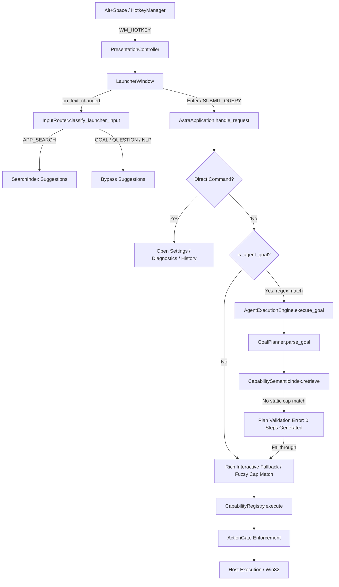

# Astra Cognitive Spine Audit: As-Built vs. As-Designed

> **Status**: COMPLETED  
> **Date**: 2026-10-05  
> **Target**: AstraRun 1.0.0-rc.6 Architecture Analysis  
> **Evaluator**: Antigravity Autonomous Pair  

---

## 1. Executive Summary

This architecture audit investigates the causal divergence between AstraRun's designed multi-tier cognitive architecture and the empirical realities uncovered in the **Capability Evaluation v1** (75.7% overall pass rate, with Dynamic Execution at 33.3% and Full Agentic Integration at 40.0%).

### Core Finding
Astra possesses an extraordinarily complete, secure, and robust foundation:
- **Rock-solid Computer Use**: Native Win32 window manipulation, UIA accessibility tree inspection and invocation, WinRT OCR, and OpenCV visual matching.
- **Uncompromised Security Boundaries**: `ActionGate`, `SecretBroker`, `TrustKernel`, and `SandboxManager` with Win32 Job Objects achieved a **100% pass rate** on adversarial and permission boundaries.
- **Durable Process Containment**: Out-of-process workers and IPC maintain high GUI stability.

**The Architectural Disconnect**:
The high-level cognitive layer (`Spark`, `Qwen2.5-Coder`, `CognitiveRouter`, and `DynamicToolBuilder`) was built in isolated modules (`src/astrarun/cognition/` and `src/astrarun/tools/dynamic_builder.py`), but **never spliced into the production execution path** in `src/astrarun/app.py` and `src/astrarun/agent/planner.py`. Consequently:
1. `GoalPlanner` relied exclusively on `CapabilitySemanticIndex` keyword lookup against 80 fixed capabilities.
2. When a user requested novel algorithms, project authoring, or dynamic data analysis (Fibonacci, 3D visualization, CSV data scripts), Astra attempted to force the request into an existing capability (e.g. `open_folder` or `reveal_file`) and failed validation.
3. Fixed capabilities accidentally became the **hard ceiling** of Astra's intelligence rather than fast-path accelerators.

---

## 2. End-to-End Execution Path Trace

Below is the complete causal trace of a user query submitted through the installed product:

### Path Trace Observations
1. **Launcher -> InputRouter**: Working as designed in RC.6. Correctly isolates natural language, questions, and goals from premature application search autocomplete.
2. **AstraApplication.handle_request**: Contains ad-hoc regex gates (`\bbattery\s+report\b`, `\bwifi\b`, or `has_compound`) to decide whether to call `agent_engine.execute_goal()`.
3. **GoalPlanner.parse_goal**: Calls `_split_clauses()` and searches `CapabilitySemanticIndex`. It has **no connection** to `CognitiveRouter`, `Spark`, or `Qwen`. If a clause cannot be satisfied by an existing capability in the 80-item catalog, it returns `capability_id = None`.
4. **AgentExecutionEngine**: Requires a valid `PlanDAG` composed of known capability steps. If 0 steps are generated, the task fails with `"Invalid plan"`, falling back to `handle_request` which attempts single-capability fuzzy resolution and fails.
5. **Cognition & Dynamic Tools Completely Bypassed**: `CognitiveRouter` (in `src/astrarun/cognition/router.py`) and `DynamicToolBuilder` (in `src/astrarun/tools/dynamic_builder.py`) were never invoked anywhere along this live execution pipeline.

---

## 3. Comprehensive Component Classification

| Component | Module Path | Classification | Reality & Causal Diagnostic |
| :--- | :--- | :---: | :--- |
| **Alt+Space Hotkey** | `astrarun.hotkeys.manager` | `CONNECTED_PRODUCTION` | Fully registered via Win32 `RegisterHotKey`; summons launcher sub-millisecond. |
| **Launcher UI** | `astrarun.ui.launcher` | `CONNECTED_PRODUCTION` | PySide6 dark UI; handles keyboard navigation, suggestion debouncing, and direct invocation. |
| **IPC Signal Bridge** | `astrarun.main` | `CONNECTED_PRODUCTION` | Named Pipe server accepts `SHOW_MAIN_UI`, `SUBMIT_QUERY`, `PAUSE`, `RESUME` seamlessly. |
| **InputRouter** | `astrarun.routing.input_router` | `CONNECTED_PRODUCTION` | Deterministic intent pre-classification runs in < 0.2ms; eliminates false app searches. |
| **AstraApplication** | `astrarun.app` | `CONNECTED_PRODUCTION` | Central composition root; coordinates tasks, window snapshots, and capability execution. |
| **TaskRuntime** | `astrarun.tasks.runtime` | `IMPLEMENTED_UNUSED` | Instantiated in `app.py` as `self.task_runtime`, but `handle_request` never dispatches tasks to it. |
| **GoalPlanner** | `astrarun.agent.planner` | `CONNECTED_PARTIAL` | Uses semantic index for fixed capabilities, but lacks neural planning and dynamic tool synthesis. |
| **AgentExecutionEngine**| `astrarun.agent.loop` | `CONNECTED_PARTIAL` | Iterative execution engine works, but is gated by regex in `app.py` and constrained by `GoalPlanner`. |
| **CapabilityRegistry** | `astrarun.capabilities.registry` | `CONNECTED_PRODUCTION` | Houses 80 built-in capabilities across OS, windowing, files, processes, and network. |
| **ActionGate** | `astrarun.security.action_gate` | `CONNECTED_PRODUCTION` | Authoritative security gatekeeper; evaluates paths, PIDs, URLs, and commands before execution. |
| **SecretBroker** | `astrarun.security.secret_broker` | `CONNECTED_PRODUCTION` | High-fidelity regex scrubbing for Anthropic, OpenAI, HuggingFace, and generic API keys. |
| **SandboxManager** | `astrarun.sandbox.manager` | `CONNECTED_PRODUCTION` | Job Object process isolation, disk redirection, execution timeouts, and artifact harvesting. |
| **DynamicToolBuilder** | `astrarun.tools.dynamic_builder` | `IMPLEMENTED_UNUSED` | Fully functional sandbox/AST pipeline, but has hardcoded plotting templates and was never wired to the planner. |
| **Laya Worker** | `astrarun.routing.laya_worker` | `BROKEN_PACKAGED` | Failed in frozen runtime due to `torchvision::nms` C++ extension absence and an outdated snapshot pointer. |
| **CognitiveRouter** | `astrarun.cognition.router` | `IMPLEMENTED_UNUSED` | Well-designed Spark (:8090) and Qwen (:8089) orchestrator, but completely orphaned. |
| **ModelClient** | `astrarun.cognition.client` | `IMPLEMENTED_UNUSED` | Loopback HTTP client with SecretBroker scrubbing; completely functional but uncalled. |
| **ModelSupervisor** | `astrarun.cognition.supervisor` | `IMPLEMENTED_UNUSED` | Win32 Job Object supervisor for `llama-server.exe`; uncalled by production startup. |
| **MachineModel** | `astrarun.machine.model` | `CONNECTED_PRODUCTION` | QueryEngine answers hardware questions accurately, but is not continuously fed to planner. |
| **Windows Controller** | `astrarun.windows.controller` | `CONNECTED_PRODUCTION` | Win32 window management (P0 `SW_SHOWMAXIMIZED` bug identified and fixed). |
| **UIA Control Provider** | `astrarun.windows.controller` | `CONNECTED_PRODUCTION` | UI Automation tree inspection and control pattern execution verified on Calculator. |
| **WinRT OCR** | `astrarun.perception.ocr` | `CONNECTED_PRODUCTION` | Native Windows 11 OCR available and functional. |
| **Classical CV (OpenCV)**| `astrarun.perception.cv` | `CONNECTED_PRODUCTION` | Template matching and visual search functional. |
| **OmniParser Grounder**| `astrarun.perception.grounder` | `CONNECTED_PARTIAL` | Model present on disk; requires runtime verification of inference pipeline. |
| **SmolVLM-500M** | `astrarun.perception.vlm` | `TEST_ONLY` | Model weights not staged in standard paths; deferred to future milestone. |
| **Hermes-Style Skills** | `astrarun.tools.registry` | `CONNECTED_PARTIAL` | Fixed capability manifests exist, but external `SKILL.md` dynamic discovery is not hooked into DAGs. |
| **RAG / MemoryStore** | `astrarun.rag`, `learning` | `CONNECTED_PARTIAL` | SQLite database persists historical launches, but context is not injected into planning prompts. |
| **Browser CDP** | `astrarun.capabilities.web` | `CONNECTED_PARTIAL` | Works if user runs browser with `--remote-debugging-port=9222`, but lacks automated session strategy. |

---

## 4. Root Causes for Architectural Divergence

1. **Premature Capability Reliance**: Early milestones prioritized deterministic reliability (80 fixed capabilities) to guarantee 100% predictability for basic desktop actions. As a consequence, `GoalPlanner` was implemented as a semantic dictionary lookup over these 80 capabilities rather than a true generative planner.
2. **Cognition Subsystem Built in Isolation**: The `src/astrarun/cognition/` module (containing `CognitiveRouter`, `ModelClient`, `ModelSupervisor`, `Spark`, and `Qwen` hooks) was developed as an advanced capability spike but was never integrated into the primary `AstraApplication.handle_request` workflow.
3. **Template-Based DynamicToolBuilder**: `DynamicToolBuilder` was built with static string formatting templates for trigonometry plots rather than accepting arbitrary, model-authored Python code from Qwen.
4. **Packaged Laya Worker Dependency Poisoning**: The frozen executable packaged `transformers` which imported `loss_for_object_detection.py`, attempting to register `torchvision::nms`. Since the compiled C++ extension was missing in the PyInstaller bundle, the worker crashed immediately on load.
5. **No Universal `run_python_script` Primitive**: The system lacked a governed general-purpose Python execution capability that could accept model-authored scripts, pass them through `ASTInspector` and `ActionGate`, and execute them within `SandboxManager`.

---

## 5. Architectural Remediation Roadmap

1. **Laya Subprocess Recovery**: Mask `torchvision` in `laya_worker.py` and ensure the HF cache snapshot points to the valid `model.safetensors`.
2. **Production ModelService**: Unify `Spark` (:8090) and `Qwen` (:8089) under a supervised `ModelService` implementing clean methods: `route()`, `plan()`, `generate_code()`, `repair_code()`, and `verify()`.
3. **Cognitive Spine Integration in GoalPlanner**:
   - Step 1: Query existing capabilities & skills (fast path).
   - Step 2: If no static capability satisfies the goal, escalate to `Qwen2.5-Coder` to synthesize a typed `CandidateTool`.
   - Step 3: Pass candidate through `ASTInspector` and `ActionGate`.
   - Step 4: Execute via `SandboxManager` within a Win32 Job Object.
   - Step 5: Observe outputs and verify against the user goal.
4. **Governed Dynamic Execution Primitive**: Register `run_sandboxed_python` as an authoritative capability.
5. **Continuous Machine Awareness**: Feed live VRAM/RAM constraints into the planning context before dispatching code generation or model execution.
