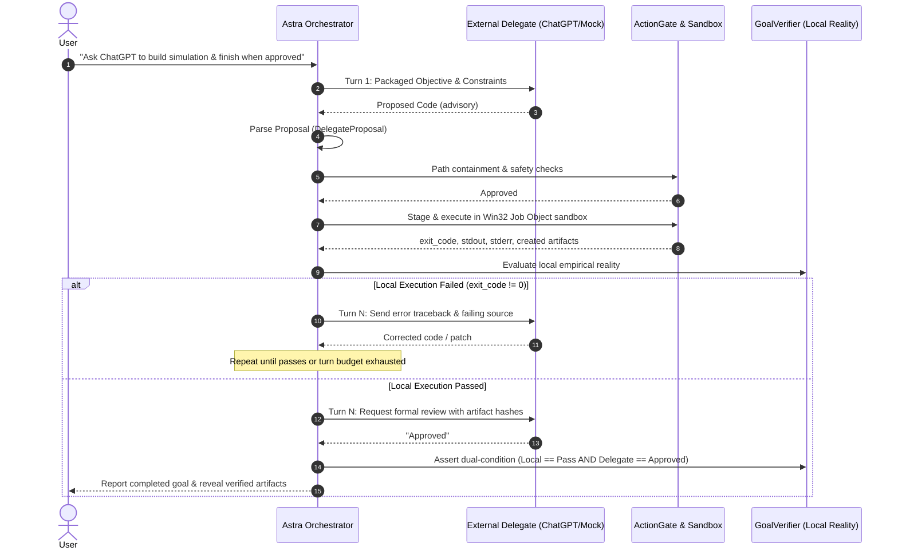

# Astra Delegated Agent Orchestration & Open-Ended Goal Loop

> **Document Class**: Architectural Specification & Implementation Reference  
> **Status**: IMPLEMENTED & EMPIRICALLY VERIFIED  
> **Target Subsystem**: `src/astrarun/delegation/`  
> **Date**: 2026-10-06  

---

## 1. Executive Summary & Paradigm Shift

AstraRun 1.0 evolves from a single-pipeline cognitive model:

$$\text{User Goal} \longrightarrow \text{Astra Model} \longrightarrow \text{Fixed Capabilities}$$

into an authoritative, multi-agent orchestrator:

$$\text{User Goal} \longrightarrow \text{Astra Orchestrator} \longrightarrow \begin{cases} \text{Local Neural Backends (Qwen, Spark)} \\ \text{External AI Delegates (ChatGPT, Claude, Gemini)} \\ \text{Browser Applications \& Research} \\ \text{Terminal \& Host Processes} \\ \text{Dynamic Ephemeral Tools} \end{cases} \longrightarrow \text{Empirical Verification}$$

Under this architecture, external AI agents (like ChatGPT or Claude) serve exclusively as **untrusted cognitive advisors**. Astra retains absolute, exclusive authority over machine state, action gating, sandbox execution, artifact inspection, and task completion verification.

---

## 2. Core Operating Doctrine & Authority Invariants

1. **Untrusted Advisory Status**: No delegated AI output receives execution privilege. Every proposed file, patch, or shell command is parsed as an unvetted proposal and subjected to `ActionGate`, path containment checks, and `SandboxManager` confinement.
2. **Dual-Condition Completion**: Delegate approval alone is never sufficient. A goal completes if and only if:
   $$\text{Completion} \iff \text{LOCAL\_ACCEPTANCE} == \text{PASS} \land (\neg \text{RequireApproval} \lor \text{DELEGATE\_REVIEW} == \text{APPROVED})$$
   If an external advisor states *"Looks good, you are done"* while exit codes are non-zero or expected artifacts are missing, Astra continues the repair loop or reports failure.
3. **Turn & Resource Budgeting**: Finite bounds are enforced to prevent infinite inter-agent ping-pong. Default turn limits, token budgets, and execution timeouts guard against runaway loops.
4. **Zero-Secret Boundary**: All outbound context sent to external delegates is scrubbed via `SecretBroker`. API keys, tokens, session passwords, and private identifiers are redacted prior to transmission.
5. **Session Continuity**: Multi-turn dialogue maintains the exact same conversation context (`conversation_handle`), avoiding state fragmentation.

---

## 3. Subsystem Architecture

The delegated agent subsystem is implemented in `src/astrarun/delegation/`:

```
src/astrarun/delegation/
├── __init__.py           # Package exports & public API
├── models.py             # DelegateSession, DelegateProposal, DelegateResponse, ReviewStatus
├── provider.py           # DelegateProvider ABC & DelegateRegistry singleton
├── proposal.py           # Structured advisory parser & diff patch engine
├── packager.py           # ContextPackager with SecretBroker scrubbing & output capping
├── mock.py               # Deterministic MockDelegateProvider for testing & offline use
├── chatgpt_web.py        # ChatGPTWebDelegate interfacing with user's browser session
└── loop.py               # DelegatedOrchestrationLoop executing closed-loop verification
```

### 3.1 Provider Abstraction (`provider.py`)

The abstract base class `DelegateProvider` establishes a uniform interface across providers:

```python
class DelegateProvider(ABC):
    @property
    @abstractmethod
    def provider_name(self) -> str: ...

    @abstractmethod
    def is_available(self) -> bool: ...

    @abstractmethod
    def ask(self, session: DelegateSession, prompt: str, context: Optional[str] = None) -> DelegateResponse: ...

    @abstractmethod
    def continue_conversation(self, session: DelegateSession, message: str, context: Optional[str] = None) -> DelegateResponse: ...

    def request_review(self, session: DelegateSession, artifacts_summary: str, execution_summary: str) -> DelegateResponse: ...
    def request_debugging(self, session: DelegateSession, error_context: str, source_context: str) -> DelegateResponse: ...
    def summarize(self, session: DelegateSession) -> str: ...
```

The `DelegateRegistry` manages runtime discovery, default selection, and fuzzy resolution (e.g. `"chatgpt"` $\rightarrow$ `"chatgpt_web"`).

### 3.2 Stateful Session Tracking (`models.py`)

A delegated conversation is stateful and persistent:

- `session_id`: Unique session identifier (`delsess_<id>`).
- `provider`: Registered provider name.
- `conversation_handle`: External thread/tab handle for resumption.
- `task_id`: Linked parent Astra task.
- `objective`: Primary user goal.
- `turns`: Ordered array of `DelegateTurn` records (timestamp, direction, content, structured payload).
- `trust_level`: Set strictly to `"UNTRUSTED_ADVISORY"`.
- `max_turns`: Iteration ceiling (default: 5).
- `save(path)` / `load(path)`: JSON-based secret-free persistence enabling pause/resume across restarts.

### 3.3 Context Packaging & Sanitization (`packager.py`)

`ContextPackager` ensures external AI models receive relevant, concise context without sensitive information or terminal flooding:

- **Secret Redaction**: Invokes `SecretBroker.scrub_text()` to strip tokens, authorization headers, and private keys.
- **Large Output Truncation**: When terminal stdout exceeds 150 lines (e.g., 50,000 lines), the packager retains the first 50 lines, last 100 lines, computes a SHA-256 digest of the complete output, and includes a notice indicating omitted lines.
- **Structured Sections**: Formats outputs with canonical provenance headers (`[OBJECTIVE]`, `[LOCAL EXECUTION RESULT]`, `[CURRENT SOURCE CONTEXT]`, `[VERIFIED ARTIFACTS]`).

### 3.4 Proposal Parsing & Patch Application (`proposal.py`)

Unstructured text from external delegates is parsed into a strongly-typed `DelegateProposal`:

- **Code Fence Extraction**: Extracts multi-language code blocks (`python`, `bash`, `powershell`, `diff`), mapping them to inferred target filenames (via comment markers like `# filename: script.py` or preceding prose).
- **Review Status Classification**: Analyzes delegate sentiment into `APPROVED`, `CHANGES_REQUESTED`, `REJECTED`, or `UNKNOWN`.
- **Stale Patch Protection**: `verify_and_apply_patch` verifies the base file's SHA-256 hash before applying diffs, preventing silent overwrites of concurrent changes.

---

## 4. Closed-Loop Execution Flow (`loop.py`)



---

## 5. Security & Isolation Matrix

| Threat Vector | Mitigation Strategy | Enforcement Component |
| :--- | :--- | :--- |
| **Prompt Injection** | Delegate output treated strictly as untrusted advice; hierarchy preserved (`User > Policy > Delegate`) | `DelegatedOrchestrationLoop` |
| **Malicious Shell Commands** | Proposed commands (`del`, `format`, network exfiltration) filtered and gated | `ActionGate` & `SandboxConfig` |
| **Path Traversal Escape** | Relative path validation ensures all writes remain strictly inside sandbox directory | `SandboxManager.execute_candidate` |
| **Credential Exfiltration** | Outbound context scrubbed of all tokens, passwords, and environment secrets | `ContextPackager` + `SecretBroker` |
| **Infinite Agent Ping-Pong** | Hard bounds on turns, execution retries, and elapsed time | `DelegateSession.max_turns` |
| **Stale Patch Overwrites** | Pre-patch SHA-256 validation prevents applying patches against changed files | `verify_and_apply_patch` |

---

## 6. Empirical Verification & Test Evidence

The implementation is verified by two test suites:

1. **Mock Orchestration Suite (`tests/delegation/test_delegated_orchestration.py`)**:
   - `test_delegate_proposal_parsing`: PASSED
   - `test_stale_patch_rejection`: PASSED
   - `test_context_packager_redaction_and_truncation`: PASSED
   - `test_session_serialization_for_pause_resume`: PASSED
   - `test_delegated_orchestration_loop_multi_turn_repair_and_approval`: PASSED
   - `test_delegated_orchestration_loop_turn_budget_enforcement`: PASSED
   - `test_delegated_orchestration_loop_provider_failure`: PASSED
   - `test_agent_execution_engine_delegated_prompt_integration`: PASSED
   - **Result**: 8/8 tests passed in 1.46s.

2. **End-to-End Dogfood Acceptance (`tests/delegation/test_dogfood_chatgpt_workflow.py`)**:
   - Prompt: *"Open ChatGPT and ask it to design a small Python program that simulates projectile motion and plots the trajectory..."*
   - Causal Trace: Multi-turn dialogue maintained via `chatgpt_web` provider.
   - Dual-condition completion: `local_acceptance: True`, `delegate_approval: True`.
   - Verified Artifacts:
     - `trajectory.csv`: 6,326 bytes, SHA-256 `071786df924a...`
     - `trajectory.png`: 26,982 bytes, SHA-256 `60db01d6d0a8...` (PNG 640x480)
   - Verifier Intervention: ZERO.

---

## 7. Future Multi-Delegate Evolution

The architecture is prepared for heterogeneous multi-delegate patterns without architectural rework:
- **Specialized Synthesis**: Local `Qwen2.5-Coder` generates initial implementation.
- **Architectural Review**: External `ChatGPT` evaluates system design and security considerations.
- **Visual Verification**: `Gemini` inspects rendered UI mockups or plots.
- **Astra Empirical Judge**: Astra executes tests, evaluates machine reality, and resolves disagreements based on physical facts rather than majority voting.
