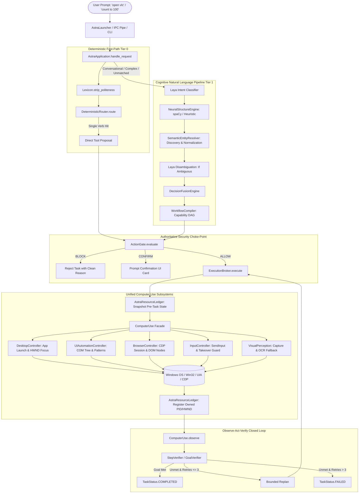

# AstraRun Universal Computer-Use Architecture Specification (F0-18)

**Document Identifier**: `F0_18_UNIVERSAL_COMPUTER_USE_ARCHITECTURE.md`  
**Status**: DRAFT / ENGINEERING SPECIFICATION  
**Target Platform**: Windows 11 Build 26200+ (x64)  
**Target Hardware**: Intel Core i5-12450H (8C/12T), 16 GB DDR4 RAM, NVIDIA GeForce RTX 2050 (4 GB VRAM)  
**Security Model**: ExecutionBroker Choke-Point + ActionGate Policy Enforcement + AppContainer Isolation  
**Date**: 2026-10-09  

---

## 1. Upstream Research Synthesis

### 1.1 Microsoft UFO2 (UI-Focused Agent 2.0)
- **Reference**: [GitHub: microsoft/UFO](https://github.com/microsoft/UFO) | [UFO Documentation](https://microsoft.github.io/UFO/)
- **Core Architecture**:
  - **Dual-Agent Hierarchy**: Decomposes computer use into a global **HostAgent** (desktop orchestration, application launch, window focus, inter-application context switching) and dedicated **AppAgent** instances (window-scoped UI automation and observation).
  - **Hybrid GUI/API Modality**: Prioritizes native application programmatic APIs/COM interfaces (e.g. Office COM, Win32 Automation) when available, falling back to accessibility tree (UI Automation) and visual perception (OmniParser) when controls are custom or untyped.
  - **Command Dispatcher & Control Patterns**: Dispatches atomic actions via a structured `CommandDispatcher` utilizing Windows UI Automation patterns (`InvokePattern`, `ValuePattern`, `SelectionPattern`, `ScrollPattern`).
  - **State Machine & Execution History**: Maintains an explicit state machine with bounded retry budgets, action step logging, and cross-application context threading.
- **AstraRun Comparative Assessment**:
  - *Applicability*: AstraRun adopts the HostAgent/AppAgent conceptual separation: top-level window/process operations belong to `DesktopController` (Host), while active window controls are targeted via `UIAutomationController` (App).
  - *Constraint & Divergence*: UFO2 relies heavily on cloud multimodal LLMs (GPT-4V / Azure OpenAI) or heavyweight multi-GPU local infrastructure (16GB+ VRAM). AstraRun operates locally on an RTX 2050 (4GB VRAM ceiling). Therefore, AstraRun enforces an **inverted perception hierarchy**: fast Win32/UIA tree queries (< 10ms, 0 VRAM) are exhausted first before any visual processing or local VLM invocation is triggered. Furthermore, AstraRun maintains non-bypassable local security choke points (`ExecutionBroker` + `ActionGate`) which UFO2 lacks.

### 1.2 Windows UI Automation (UIA)
- **Reference**: [Microsoft Win32 UI Automation Core](https://learn.microsoft.com/en-us/windows/win32/winauto/entry-uiauto-win32) | [Control Pattern Overview](https://learn.microsoft.com/en-us/windows/win32/winauto/uiauto-controlpatternsoverview)
- **Key Concepts**:
  - **Element Identity**: Control elements are identified by `AutomationId` (most stable across localizations and sessions), `ControlType` (semantic element role, e.g. Button, Edit, Document), and `Name` (localized accessibility label).
  - **Control Patterns**: Direct programmatic manipulation through native COM pattern interfaces:
    - `InvokePattern`: Deterministic action execution for buttons, menu items, hyperlinks without mouse motion.
    - `ValuePattern`: Direct string setting for text boxes and edit fields without keyboard keystroke injection.
    - `SelectionItemPattern` / `SelectionPattern`: Dropdowns, radio buttons, tab selections.
    - `ScrollPattern` / `ScrollItemPattern`: Precise view navigation.
    - `WindowPattern`: Modal dialog detection, minimize/maximize state queries.
  - **BoundingRectangle & Physical Coordinate Fallback**: When controls implement custom rendering (e.g., DirectUI, WPF, Electron) and reject COM pattern calls, the element's `BoundingRectangle` provides verified client screen coordinates `(x, y, w, h)` for governed physical click fallback via `SendInput`.
  - **Stale Element Handling**: UIA COM handles frequently become invalid across window redraws, tab switches, or modal dismissals (`COMError` 0x80040201 `UIA_E_ELEMENTNOTAVAILABLE`). Robust agents must never cache raw COM pointers across action steps; every step must re-query or verify element liveness via `CurrentProcessId` or `CurrentIsEnabled`.

### 1.3 Microsoft OmniParser
- **Reference**: [GitHub: microsoft/OmniParser](https://github.com/microsoft/OmniParser)
- **Core Architecture**:
  - Two-stage visual screen parsing: (1) Fine-tuned YOLOv8 model detects interactable icon/bounding-box proposals; (2) Florence-2 / BLIP-2 VLM extracts semantics and functional descriptions.
- **AstraRun Comparative Assessment**:
  - *Applicability*: Useful for applications where UI Automation trees are sparse or inaccessible (e.g., games, non-standard Qt widgets, legacy Canvas, Citrix/RDP streams).
  - *Resource Constraint*: Running YOLOv8 + Florence-2 concurrently exceeds our 4GB VRAM ceiling when local LLMs (Spark 1.7B / Qwen 1.5B) are resident. AstraRun therefore uses **on-demand fallback**: local OpenCV template matching and lightweight Tesseract OCR first, reserving VLM visual grounding strictly for escalated, non-standard canvas surfaces.

### 1.4 Browser Use & Chrome DevTools Protocol (CDP)
- **Reference**: [GitHub: browser-use/browser-use](https://github.com/browser-use/browser-use) | [Chrome DevTools Protocol](https://chromedevtools.github.io/devtools-protocol/)
- **Core Architecture**:
  - Direct CDP connection over WebSockets (default remote debugging port `9222`).
  - Domains: `Page` (lifecycle, navigation, load status), `DOM` (node resolution, attributes), `Accessibility` (AXTree extraction), `Runtime` (in-page JS evaluation), `Target` (multi-tab/iframe discovery), `Input` (synthetic mouse/keyboard dispatch).
  - DOM token compression: Strips invisible/redundant DOM elements, compresses node identifiers, and maps interactive CSS selectors to compact numeric tokens for LLM context optimization.
- **AstraRun Comparative Assessment**:
  - AstraRun's `BrowserService` implements native CDP connection to Edge and Chrome. Rather than vendor-specific automation (such as hardcoded `has_chatgpt_tab`), AstraRun consolidates browser control into a generic `BrowserController` capable of discovering tabs, navigating URLs, evaluating DOM trees, clicking selectors, and verifying network/page idle states.

### 1.5 OSWorld-V2
- **Reference**: [GitHub: xlang-ai/OSWorld-V2](https://github.com/xlang-ai/OSWorld-V2)
- **Core Architecture**:
  - Real-world OS benchmark across Office, VS Code, Chrome, VLC, Thunderbird, OS settings.
  - Emphasizes **environmental reproducibility**, **deterministic ground-truth verification** (checking file outputs, process state, and accessibility state rather than assuming command exit code == success), and **generalization across unseen applications**.
- **AstraRun Comparative Assessment**:
  - Validates AstraRun's core design invariant: API success $\neq$ goal completion. Every computer-use action must conclude with an explicit verification phase that verifies environmental side-effects.

---

## 2. Existing Production Architecture & Call Graph

### 2.1 Component Inventory (84 Registered Capabilities)
AstraRun's capabilities span:
1. `applications`: Launch, terminate, resolve installed apps via `AppDiscoveryCache`.
2. `windows`: HWND discovery, layout, snapping, focus, minimize/maximize.
3. `interaction`: COM UI Automation (`IUIAutomation`), physical `SendInput`, keyboard shortcuts.
4. `browser`: CDP port 9222 session control, tab switching, DOM node evaluation.
5. `perception`: Screen capture, OCR, CV template matching, VLM fallback.
6. `filesystem`: Safe workspace reads/writes, file discovery, path normalization.
7. `delegation`: External advisory consultation.
8. `security`: `ExecutionBroker`, `ActionGate`, `TrustKernel`, `AstraResourceLedger`.

### 2.2 Actual Source-Derived Call Graph



---

## 3. Semantic Entity Resolution & Candidate Normalization

### 3.1 Problem Definition
In prior builds, user input `"open vlc"` triggered naive substring/fuzzy searches against the Start Menu cache, producing 4 raw candidates:
1. `VLC media player` (Score 0.929)
2. `VLC media player skinned` (Score 0.926)
3. `VLC media player - reset preferences and cache files` (Score 0.923)
4. `Vlc` (Score 1.000)

This exposed maintenance and alternate skin shortcuts to users or caused arbitrary selection of non-primary binaries.

### 3.2 Solution Architecture: Multi-Stage Semantic Entity Resolver
1. **Shortcut Sanitization Filter**:
   - Filter out maintenance, reset, diagnostic, troubleshooter, configuration, safe mode, and documentation shortcuts during initial Start Menu enumeration in `AppDiscoveryCache`:
     ```python
     EXCLUDE_SHORTCUT_TOKENS = {
         "uninstall", "help", "documentation", "readme", "website", "remove",
         "setup", "license", "reset", "cache", "troubleshoot", "diagnostic",
         "repair", "safe mode", "configuration", "settings", "updater", "profile", "debug"
     }
     ```
2. **Canonical Candidate Clustering & Scoring**:
   - For any query string (e.g. `"vlc"`, `"media player"`, `"code"`), candidates are clustered by base executable identity.
   - Exact executable match (`vlc.exe`) and root application names receive highest priority.
   - Suffixes like `"skinned"`, `"portable"`, `"command prompt"` receive heavy penalties unless explicitly requested by the user.
3. **Laya Semantic Disambiguation**:
   - When multiple legitimate distinct applications score within a narrow confidence threshold (e.g., `"media player"` matching both `Windows Media Player` and `VLC media player`), Laya semantic scoring evaluates context or prompts for user clarification.
   - Maintenance shortcuts are strictly quarantined and never selected silently.

---

## 4. General Intent Routing (12 Semantic Classes)

AstraRun classifies natural language input into 12 distinct semantic intent classes:

| Class | Intent Category | Example Prompts | Routed Capability / Subsystem | Security Policy |
| :---: | :--- | :--- | :--- | :--- |
| **1** | `APPLICATION_LAUNCH` | `"open vlc"`, `"launch paint"`, `"can u bring up chrome"` | `applications.service.open_application` | `ALLOW` (Standard application) |
| **2** | `APPLICATION_CLOSE` | `"close vlc"`, `"quit paint"` | `applications.service.close_application` | `ALLOW` (Owned) / `CONFIRM` (Unowned) |
| **3** | `WINDOW_MANAGEMENT` | `"minimize window"`, `"snap left"`, `"maximize edge"` | `windows.controller.snap_active_window` | `ALLOW` |
| **4** | `SYSTEM_OBSERVATION` | `"is vlc installed?"`, `"is chrome running?"` | `applications.service.is_app_installed` | `ALLOW` (Read-only, zero side-effects) |
| **5** | `FILE_OPERATION` | `"show files in downloads"`, `"read summary.txt"` | `filesystem.read_file`, `filesystem.list_dir` | `ALLOW` (Workspace) / `CONFIRM` (External) |
| **6** | `BROWSER_OPERATION` | `"search arxiv for transformers"`, `"open github.com"` | `browser.service.navigate` | `ALLOW` (Public web) |
| **7** | `COMPUTATIONAL_TASK` | `"count to 100"`, `"what is 25 * 40?"` | Spark Cognitive Engine / Local Math Evaluation | `ALLOW` (Pure computation, no OS launch) |
| **8** | `MULTISTEP_WORKFLOW` | `"take a screenshot and open it in paint"` | `WorkflowCompiler` multi-step DAG | `ALLOW` per step via `ActionGate` |
| **9** | `CONVERSATIONAL_REQUEST`| `"hello"`, `"who are you"`, `"thank you"` | Spark Chat Assistant | `ALLOW` (Conversational response only) |
| **10**| `CLARIFICATION_REQUIRED`| `"open player"` (ambiguous across VLC & Windows Media) | Conversational clarification dialog | `ALLOW` |
| **11**| `NEGATION_SAFETY` | `"don't open vlc"`, `"do not close notepad"` | Safety refusal / No-op confirmation | `BLOCK` (Prevents accidental launch) |
| **12**| `SECURITY_DENIAL` | `"delete system32"`, `"format c:"`, `"run unsigned payload"`| `ActionGate` Security Quarantine | `BLOCK` (Authoritative security reject) |

---

## 5. Unified ComputerUse Facade Specification

The unified `ComputerUse` service (`src/astrarun/computer_use/facade.py`) provides a clean, coherent facade consolidating disparate lower-level interaction modules:

```python
class ComputerUse:
    """Unified facade for AstraRun computer-use capabilities."""

    def observe(self, window_target: Optional[str] = None) -> ComputerUseObservation:
        """Captures structured state: active HWND, window title, UIA tree, and browser tabs."""
        ...

    def discover(self, query: str) -> List[ApplicationCandidate]:
        """Discovers applications matching query via sanitized AppDiscoveryCache."""
        ...

    def resolve(self, query: str) -> EntityResolutionResult:
        """Resolves target query to canonical executable, excluding maintenance shortcuts."""
        ...

    def find_element(self, selector: ControlSelector) -> Optional[UIElement]:
        """Finds interactable control via UIA tree with AutomationId / Name / ControlType."""
        ...

    def interact(self, action: UIAction) -> ExecutionResult:
        """Executes UI action: UIA pattern invocation with physical coordinate click fallback."""
        ...

    def verify(self, condition: VerificationCondition) -> VerificationResult:
        """Verifies environmental side-effects: window opened, text present, process running."""
        ...

    def recover(self, error: FailureContext) -> RecoveryAction:
        """Executes bounded recovery: re-observe, clear dialogs, retry up to MAX_REPLANS."""
        ...
```

### Observation Structure (`ComputerUseObservation`)
```python
@dataclass
class ComputerUseObservation:
    timestamp: float
    active_window: Optional[WindowInfo]
    focused_element: Optional[UIElementInfo]
    interactable_elements: List[UIElementInfo]
    browser_sessions: List[BrowserTabInfo]
    desktop_resolution: Tuple[int, int]
    user_taking_over: bool
    source_backend: str  # "UIA", "WIN32", "CDP", "CV"
    confidence: float
```

---

## 6. Architecture Consolidation Decisions

### 6.1 Reused Components
1. `src/astrarun/windows/controller.py` & `resolver.py`: Mature Win32 HWND enumeration and placement.
2. `src/astrarun/interaction/discovery.py` & `controller.py`: Comprehensive COM UI Automation tree walker.
3. `src/astrarun/perception/input.py` & `keyboard.py`: Win32 `SendInput` coordinate normalization and takeover detection.
4. `src/astrarun/browser/service.py`: Chromium CDP WebSocket protocol engine.
5. `src/astrarun/tasks/resource_ledger.py`: Complete process/window ownership registry and teardown tracking.
6. `src/astrarun/security/execution_broker.py` & `action_gate.py`: Authoritative security gates.

### 6.2 Modified Components
1. `src/astrarun/discovery/apps.py`: Expanded exclusion list to purge maintenance, reset, and troubleshooting shortcuts; added canonical candidate clustering.
2. `src/astrarun/nlp/clause_decomposer.py` & `lexicon.py`: Enhanced polite prefix stripping and expanded dynamic verb mapping.
3. `src/astrarun/routing/deterministic.py`: Integrated entity resolution and leading article normalization.
4. `src/astrarun/interaction/controller.py`: Added automatic coordinate click fallback via `element.bounds` when COM patterns fail.
5. `src/astrarun/applications/service.py`: Generalized tabbed application isolation (replacing hardcoded `notepad`).
6. `src/astrarun/delegation/chatgpt_web.py`: Refactored to generic browser AI assistant adapter.

### 6.3 Removed / Bypassed Code
1. Direct submission of `tool="unknown"` to `ActionGate`.
2. Hardcoded application aliases in `resource_ledger.py` (`calc`, `notepad`).
3. Hardcoded invariant relaunch logic in `runtime.py`.

---

## 7. Security Boundaries & Invariants

1. **Non-Bypassable Gate**: No computer-use action may execute without passing through `ActionGate.evaluate()`.
2. **Dynamic Code Isolation**: Code generated by LLM reasoning runs exclusively inside AppContainer sandbox workers with allowlisted environments.
3. **Resource Ownership Invariant**: Astra may terminate or clean up only processes and windows whose creation was initiated and recorded by `AstraResourceLedger`. Pre-existing user windows are never closed.
4. **Physical Takeover Priority**: Synthetic mouse and keyboard inputs pause immediately when physical user input is detected via `check_user_takeover()`.
5. **Zero Secret Leakage**: No credential or authorization token is logged or passed in unencrypted UI observations.

---

## 8. Hardware Footprint & Resource Impact

- **VRAM Budget**: RTX 2050 (4 GB physical VRAM).
  - Laya ONNX Engine: ~120 MB RAM / 0 VRAM.
  - Spark-X2.5-1.7B (Q4_K_M GGUF): ~1.2 GB VRAM.
  - Qwen2.5-Coder-1.5B (Q4_K_M GGUF): Loaded on demand for code generation (~1.1 GB VRAM).
  - UI Automation & Win32: 0 VRAM, negligible CPU (< 0.5%).
  - Fast-Path Latency: < 15ms response time on local CPU.
- **Responsiveness**: PySide6 GUI operates on a dedicated Qt event loop; all heavy model inference and UIA tree traversals run in background QThreads or worker processes.
