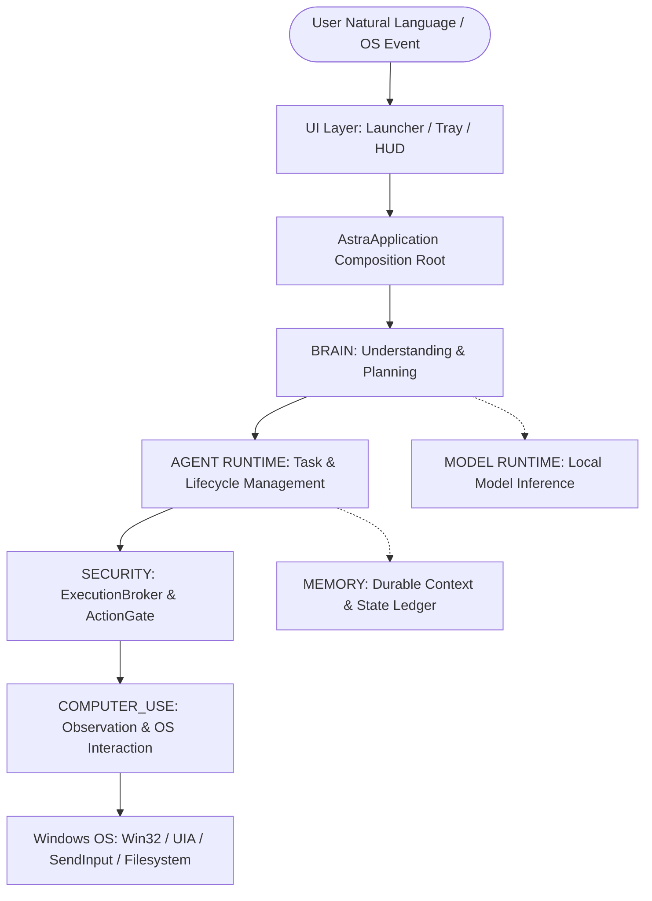
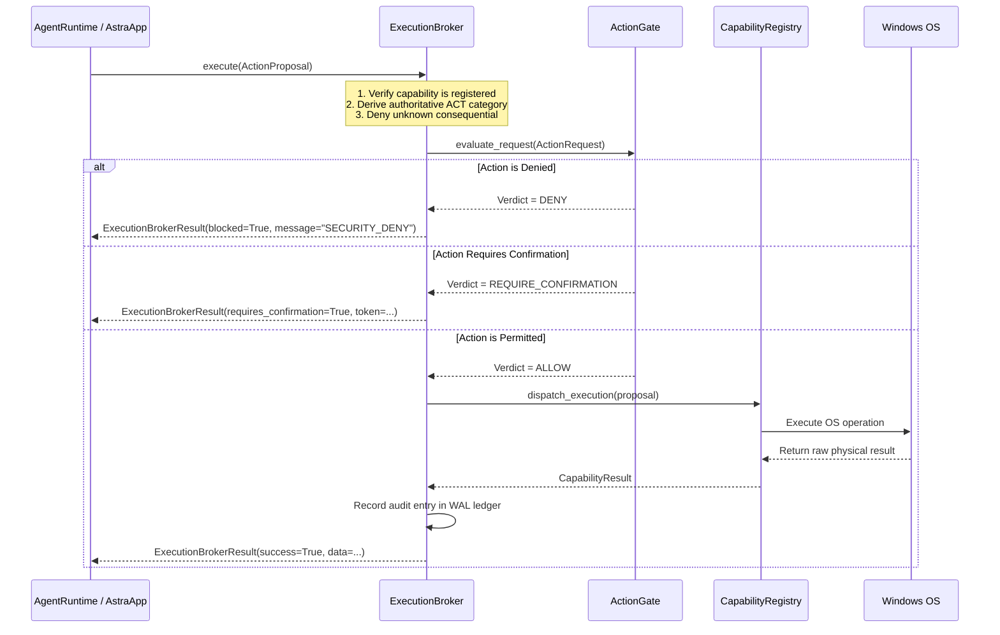

# CURRENT PRODUCT ARCHITECTURE — AstraRun Desktop Operating System Agent

> **Status**: AUTHORITATIVE / SOURCE-DERIVED  
> **Milestone**: Phase F0-22 Reality Audit & Architectural Consolidation  
> **Source-Tree Composite SHA-256**: `caf997b40a93761e1a7afc3ad4bf2b457eca28631ef86e52eceeb9e35d999a83`  
> **Audit Date**: 2026-10-09  

---

## 1. Documentation Truth Audit

An exhaustive source audit compared previously published architecture documents against actual runtime implementations across all 306 Python modules in `src/astrarun/`:

| Architecture Claim / Subsystem | Prior Document Reference | Source Status | Reality Classification | Forensic Evidence & Source Wiring |
| :--- | :--- | :--- | :--- | :--- |
| **Neural Intent Routing (Laya)** | `docs/LAYA_RESEARCH.md` | Active | `IMPLEMENTED_AND_WIRED` | `astrarun.routing.laya.LayaWorker` subprocess runs transformer-based intent classifier with ONNX runtime fallback. |
| **Deterministic Intent Routing** | `docs/NLP_ARCHITECTURE.md` | Active | `IMPLEMENTED_AND_WIRED` | `astrarun.routing.deterministic.DeterministicRouter` handles fast-path regex and known command patterns. |
| **Duplicate NLP Intent Router** | `docs/NLP_ARCHITECTURE.md` | Inactive | `OBSOLETE` | `astrarun.nlp.intent_router.IntentRouter` was duplicated in Phase 2; not wired in production `AstraApplication`. |
| **LLM Reasoning & Planning (Spark)** | `docs/architecture-research/16_SPARK_X25_RESEARCH.md` | Active | `IMPLEMENTED_AND_WIRED` | `astrarun.planning.goal_planner.GoalPlanner` integrates local GGUF models via llama-cpp runtime. |
| **Empirical Goal Verification** | `docs/audit/F0_20_WORLD_STATE_ARCHITECTURE.json` | Active | `IMPLEMENTED_AND_WIRED` | `astrarun.planning.verification.GoalVerifier` executes empirical disk and OS state assertions. |
| **Shallow Return-Code Verifier** | `docs/ARCHITECTURE.md` | Secondary | `PARTIAL` | `astrarun.tasks.verifier.TaskVerifier` only verified capability return codes; superseded by empirical verifier. |
| **Security Broker & Action Gate** | `docs/CAPABILITY_ARCHITECTURE.md` | Active | `IMPLEMENTED_AND_WIRED` | `astrarun.security.execution_broker.ExecutionBroker` enforces fail-closed gate before all consequential mutations. |
| **Universal Computer Use (UIA + Win32)** | `docs/architecture-research/F0_18_UNIVERSAL_...` | Active | `IMPLEMENTED_AND_WIRED` | `astrarun.computer_use.controller.ComputerUseController` and `astrarun.windows.controller.WindowController`. |
| **Visual Computer Use / OCR Grounding** | `docs/VISUAL_COMPUTER_USE_RESEARCH.md` | Active | `PARTIAL` | OCR grounding (`pytesseract`/`easyocr`) and screenshot capture exist; VLM visual grounding is gated on model presence. |
| **CDP Web Automation** | `docs/architecture-research/09_BROWSER_RESEARCH.md` | Active | `IMPLEMENTED_AND_WIRED` | `astrarun.browser.service.BrowserService` operates Playwright CDP for browser delegation. |
| **Hermes Continuous Self-Evolution** | `docs/HERMES_LEARNING_RESEARCH.md` | Passive | `RESEARCH_ONLY` | Research documents describe autonomous prompt rewriting; runtime contains read-only learning ledger. |
| **Autonomous Model Fine-Tuning** | `docs/SELF_EVOLUTION_RESEARCH.md` | None | `FALSE/OVERSTATED` | No runtime training pipelines exist in production binary. |

---

## 2. High-Level Architectural Ownership

The AstraRun desktop operating system agent is partitioned into seven distinct functional layers:



### Layer Responsibilities & Strict Boundaries:

1. **`BRAIN` (`astrarun.brain`, `astrarun.nlp`, `astrarun.planning`, `astrarun.routing`)**
   - **Role**: Understands user intent, extracts entities, constructs `GoalContract` predicates, generates execution plans, generates replans upon failure.
   - **Boundary Invariant**: **Pure cognitive processing**. Must NEVER directly manipulate HWNDs, mutate files, or launch processes. All action execution is delegated to Agent Runtime.

2. **`AGENT_RUNTIME` (`astrarun.agent`, `astrarun.tasks`, `astrarun.workflows`, `astrarun.execution`)**
   - **Role**: Manages task graphs, step execution lifecycles, checkpoints, adaptive closed loops (Act $\rightarrow$ Observe $\rightarrow$ Verify $\rightarrow$ Replan), and resource ownership ledgers.
   - **Boundary Invariant**: Never executes capabilities directly; must dispatch every step through `ExecutionBroker`.

3. **`SECURITY` (`astrarun.security`, `astrarun.broker`, `astrarun.gate`)**
   - **Role**: Authoritative choke-point governing all consequential machine actions. Evaluates risk levels, sandboxing constraints, elevation status, and user confirmation tokens.
   - **Boundary Invariant**: Fails closed. Cannot be bypassed by cognitive model outputs or caller-declared categories. Unknown capabilities are blocked.

4. **`COMPUTER_USE` (`astrarun.capabilities`, `astrarun.computer_use`, `astrarun.interaction`, `astrarun.windows`, `astrarun.vision`)**
   - **Role**: Performs physical interactions with the Windows OS: UI automation (UIA), Win32 window management, keyboard/mouse input simulation (`SendInput`), screen capture, OCR, and process supervision.
   - **Boundary Invariant**: Does not decide semantic intent or evaluate goal completion. Executes discrete operations and reports objective physical measurements.

5. **`MEMORY` (`astrarun.memory`, `astrarun.knowledge`, `astrarun.learning`, `astrarun.state`, `astrarun.storage`)**
   - **Role**: Persists durable context, execution history, episodic traces, semantic memories, and application index caches in SQLite WAL databases.

6. **`MODEL_RUNTIME` (`astrarun.models`, `astrarun.inference`, `astrarun.runtime`)**
   - **Role**: Hosts and isolates local ONNX and GGUF neural networks (Laya 100M intent classifier, Spark reasoning model, Qwen vision-language model).

7. **`UI` (`astrarun.ui`, `astrarun.visualization`, `astrarun.hud`, `astrarun.tray`)**
   - **Role**: Renders launcher UI, system tray icon, feedback notifications, and desktop HUD.
   - **Boundary Invariant**: Never executes capabilities directly. Routes user requests exclusively through `AstraApplication.handle_request()`.

---

## 3. Authoritative Brain Call Graph

```
Raw User Utterance
  │
  ├──► [Routing Pipeline] (astrarun.routing.pipeline)
  │      ├── Deterministic Regex Fast-Path (astrarun.routing.deterministic)
  │      └── Laya Neural Intent Classifier (astrarun.routing.laya)
  │
  ├──► [Entity Extraction & Context Resolution] (astrarun.context.resolver)
  │      ├── Application Resolution (app_indexer / registry)
  │      ├── File / Path Resolution (canonical desktop/temp path normalization)
  │      └── Modality Detection (DIRECT_RESULT_ALLOWED vs APPLICATION_UI_REQUIRED)
  │
  ├──► [GoalContract Synthesis] (astrarun.planning.goal_contract)
  │      ├── User Intents & Target Application
  │      ├── Modality: DIRECT_RESULT_ALLOWED | APPLICATION_UI_REQUIRED
  │      ├── Required State Predicates (e.g., file_exists, file_has_content, window_title_contains)
  │      └── Negative Constraints (e.g., no unrequested File Explorer windows)
  │
  ├──► [Adaptive Goal Planning] (astrarun.planning.goal_planner)
  │      ├── Step 1: open_application (Launch app window & wait for HWND)
  │      ├── Step 2: focus_window & verify_editor_surface (Observe editor control)
  │      ├── Step 3: type_into_window (SendInput typing text into editor)
  │      ├── Step 4: save_document_ui (Generic File -> Save / Ctrl+S dialog workflow)
  │      └── Step 5: close_transient_dialogs (Clean up save dialogs)
  │
  ├──► [Agent Execution Engine] (astrarun.agent.loop & astrarun.tasks.runtime)
  │      └── Closed Perceptual Loop:
  │            ACT ──► ExecutionBroker ──► ActionGate ──► OS Interaction
  │            OBSERVE ──► Window / UIA / Screen Inspection
  │            VERIFY ──► GoalVerifier (Empirical Disk & UI Predicates)
  │            REPLAN (if predicate fails) ──► GoalReplanner
  │
  └──► [Final Verification & Resource Cleanup]
         ├── Assert ALL GoalContract predicates SATISFIED
         ├── Assert ZERO false-completion predicates violated
         └── Clean up transient resources owned by task
```

---

## 4. Computer Use Interaction Surface

AstraRun interacts with Windows through four strictly segregated tiers:

1. **Win32 API (`astrarun.windows.controller`)**:
   - Window enumeration (`EnumWindows`, `GetWindowText`, `GetClassName`)
   - Window placement and focus (`SetForegroundWindow`, `ShowWindow`, `BringWindowToTop`)
   - Process mapping (`GetWindowThreadProcessId`)
   - Clean window close (`PostMessage(hwnd, WM_CLOSE, 0, 0)`)

2. **UI Automation (`pywinauto` / `UIAutomation` in `astrarun.computer_use.controller`)**:
   - Deep control tree inspection (document editor pane, menu items, edit fields in save dialogs)
   - Value pattern inspection (verifying text inside editor controls without relying on screen OCR alone)
   - Control identification by AutomationId, Name, and ControlType.

3. **Input Simulation (`SendInput` via `astrarun.interaction.service`)**:
   - Hardware-level keyboard and mouse simulation using `ctypes.windll.user32.SendInput`.
   - Keyboard shortcuts (`Ctrl+S`, `Ctrl+O`, `Enter`, `Esc`).

4. **Visual Grounding & Perception (`astrarun.vision.screen`)**:
   - High-fidelity screen capture via `mss` / `PIL.ImageGrab`.
   - Local OCR text extraction via Tesseract / EasyOCR.

---

## 5. Security & Isolation Call Graph

Every consequential operation in AstraRun is intercepted by an authoritative, immutable gate:



---

## 6. Real-World Interaction Modalities

To resolve the root cause of previous compound editor failures, AstraRun enforces two distinct interaction modalities:

### `DIRECT_RESULT_ALLOWED`
- **Use Case**: Background automation or data extraction where the user explicitly requests file operations without asking to interact through an application.
- **Example**: `"Create a file named notes.txt on desktop containing summary"`.
- **Allowed Capabilities**: `save_text_file`, `create_file`, direct filesystem writes.

### `APPLICATION_UI_REQUIRED`
- **Use Case**: Compound workflows where an application is requested to edit, display, or save data.
- **Example**: `"open notepad type hello and save it to desktop with name test1.txt"`.
- **Mandatory Workflow**:
  1. Launch the requested application and verify window HWND exists.
  2. Locate the editable document control (e.g. `Document` or `Edit` control).
  3. SendInput typing the requested text into the active editor.
  4. Verify editor text content physically matches the requested text.
  5. Invoke the application's Save command (`Ctrl+S` or File $\rightarrow$ Save).
  6. If a Save As dialog appears:
     - Focus the filename edit field.
     - Set the requested filename (`test1.txt`).
     - Set the requested directory (`Desktop`).
     - Click the Save button or send `Enter`.
  7. Verify on disk that the file exists and contains the requested text.
  8. Verify that NO unrequested windows (such as File Explorer) were spawned.
  9. Clean up any transient dialogs or resources owned by the task.

---

## 7. Zero False-Completion Verification Guarantee

1. **Empirical Verification**: Return codes (`success=True`) from capabilities are treated as unverified claims. A goal is only declared complete when all `GoalContract` predicates evaluate to `True` against physical OS state.
2. **Negative Invariants**: Verification checks ensure no unwanted side effects occurred (e.g. spawning File Explorer windows during file verification).
3. **Fail-Closed Replanning**: If any predicate fails, replanning is constrained to actions that advance unsatisfied predicates. If recovery fails within bounded attempts, the task is marked `FAILED` rather than pretending success.
