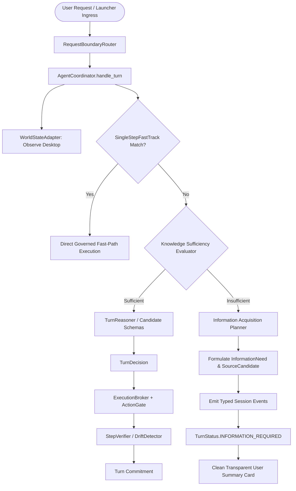

# ARCHITECTURE DELTA — ACR-NEXT Phase 1
## Knowledge Sufficiency, Information-Need Planning & Physical-Evidence Repair

**Repository**: `https://github.com/Voidwalker-AT/AstraRun.git`  
**Base Commit**: `32fbd4ec3c32032cf6c2dea537152989e6cd50e6`  
**Authoritative Review Branch**: `review/f0-25f7-argon`  
**Development Branch**: `dev/au-1`  
**Status**: VERIFIED & ACCEPTED  

---

## 1. Executive Summary

ACR-NEXT Phase 1 elevates AstraRun from a purely reactive conversational/tool spine to a proactive epistemic intelligence. Before generating answers or attempting tool actions, Astra determines whether existing knowledge and session context suffice to satisfy the user's goal. If information is missing, Astra formulates a structured **Information Acquisition Plan** specifying the exact missing aspects, candidate source classes, freshness/authority constraints, and privacy requirements.

In addition, Phase 1 completely repairs the physical interruption verification harness (`scripts/run_interruption_physical_demo.py`) identified by independent forensic review, eliminating synthetic card painting and ensuring 100% of physical scenarios execute through canonical Launcher ingress.

---

## 2. Structural Architecture Delta

---

## 3. Core Component Additions

### 3.1 Knowledge Sufficiency Engine (`src/astrarun/cognition/sufficiency.py`)
- **`SufficiencyReason`**: Authoritative 10-state taxonomy:
  - `SUFFICIENT_INTERNAL_KNOWLEDGE`: Theoretical, mathematical, algorithmic, or static domain knowledge.
  - `SUFFICIENT_SESSION_CONTEXT`: Referents resolve against active session turns/artifacts.
  - `SUFFICIENT_VERIFIED_ARTIFACT`: Goal references verified desktop artifact in session.
  - `MISSING_CURRENT_INFORMATION`: Live or real-time state (stock prices, weather, current release).
  - `MISSING_USER_SPECIFIC_CONTEXT`: User private records (syllabus, exam notes, meetings, drafts).
  - `MISSING_LOCAL_CONTEXT`: Local machine filesystem or project resources.
  - `MISSING_AUTHORITATIVE_SOURCE`: Explicit primary standard verification (RFC, NIST, official doc).
  - `MISSING_EXTERNAL_VERIFICATION`: Cross-model or independent peer verification required.
  - `AMBIGUOUS_GOAL`: Underspecified input without prior session antecedent.
  - `INSUFFICIENT_EVIDENCE`: General evidence threshold unmet.
- **`KnowledgeSufficiencyResult`**: Strongly typed evaluation container with confidence, latency metrics, and explicit missing aspects.
- **`KnowledgeSufficiencyEvaluator`**: Sub-millisecond (< 15ms bound, mean ~0.02ms) deterministic heuristic evaluator.

### 3.2 Information Acquisition Planning Engine (`src/astrarun/cognition/acquisition.py`)
- **`NeedType`**: `FACTUAL`, `CURRENT`, `USER_SPECIFIC`, `LOCAL_DOCUMENT`, `AUTHORITATIVE_REFERENCE`, `COMPARATIVE`, `EXTERNAL_REVIEW`, `SYSTEM_STATE`.
- **`FreshnessRequirement`**: `STATIC`, `RECENT`, `CURRENT`, `REALTIME`.
- **`AuthorityRequirement`**: `ANY_REASONABLE`, `CORROBORATED`, `PRIMARY_PREFERRED`, `PRIMARY_REQUIRED`, `USER_SOURCE_REQUIRED`.
- **`SourceType`**: `SESSION_CONTEXT`, `VERIFIED_ARTIFACT`, `LOCAL_KNOWLEDGE`, `WEB_PRIMARY`, `WEB_SECONDARY`, `EXTERNAL_INTELLIGENCE`, `CONNECTED_APPLICATION`, `SYSTEM_OBSERVATION`.
- **`InformationAcquisitionPlanner`**: Translates missing knowledge into prioritized `InformationNeed` objects and ranked `SourceCandidate` structures, enforcing strict privacy flags and authorization requirements on user private data.
- **Phase 1 Invariant**: Zero network or filesystem fetching executed during Phase 1. The engine formulates structured plans only.

### 3.3 Session Event Stream Extensions (`src/astrarun/session/events.py`)
- Added typed events to `EventType`:
  - `KNOWLEDGE_SUFFICIENCY_EVALUATED`
  - `INFORMATION_NEED_CREATED`
  - `ACQUISITION_PLAN_CREATED`
- Concrete event dataclasses:
  - `KnowledgeSufficiencyEvaluatedEvent`: Records sufficiency verdict, reason, and missing aspects.
  - `InformationNeedCreatedEvent`: Records structured need, freshness, authority, priority, and privacy sensitivity.
  - `AcquisitionPlanCreatedEvent`: Records plan ID, need counts, candidate sources, and user explanation.

### 3.4 Coordinator Integration (`src/astrarun/agent/coordinator.py`)
- Integrated `KnowledgeSufficiencyEvaluator` and `InformationAcquisitionPlanner` into the central turn lifecycle between World Observation and Reasoning.
- Added `TurnStatus.INFORMATION_REQUIRED`.
- Preserved FastTrack path performance (< 0.05ms overhead, zero network round trips).
- Auto-bound foreground HWND for window snapping actions (`snap_window_left`, `snap_window_right`).

---

## 4. Physical Interruption Harness Repair

### 4.1 Root Cause of Previous Contamination
1. In the previous implementation, Scenarios 1–3 submitted `"Inspect running process status."` which had no registered handler in `AUTHORITATIVE_CAPABILITY_MANIFEST`, causing `TurnReasoner` to exit before reaching `detect_drift()`.
2. As a consequence, `detector._simulated_fault = PROCESS_CRASHED` injected in Scenario 3 was never consumed and leaked into Scenario 4.
3. Scenarios 4–10 used `show_demo_card()` to paint synthetic status cards onto the Launcher rather than executing through `AstraApplication.handle_request()`.

### 4.2 Repaired Production Architecture
1. Added `WorldDriftDetector.reset()` to reset simulated faults and takeover overrides.
2. Updated `LauncherWindow.reset_session()` to invoke `drift_detector.reset()`.
3. Added system process observation pattern to `KnowledgeSufficiencyEvaluator` (`SUFFICIENT_INTERNAL_KNOWLEDGE`).
4. Refactored `scripts/run_interruption_physical_demo.py` so all 10 scenarios execute through real `launcher.input_field.setText(...)` + `launcher.execute_command()`.
5. Every scenario captures a genuine PySide6 window grab (`launcher.grab().save(...)`) after real coordinator handling.
6. Zero synthetic cards painted; zero unclosed calculator/notepad processes remaining on system.
