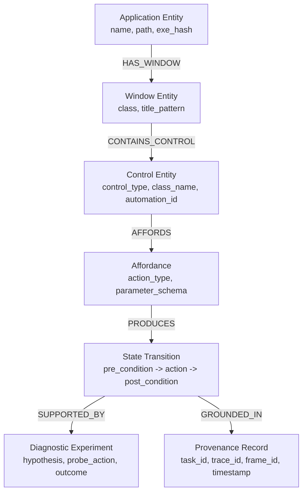
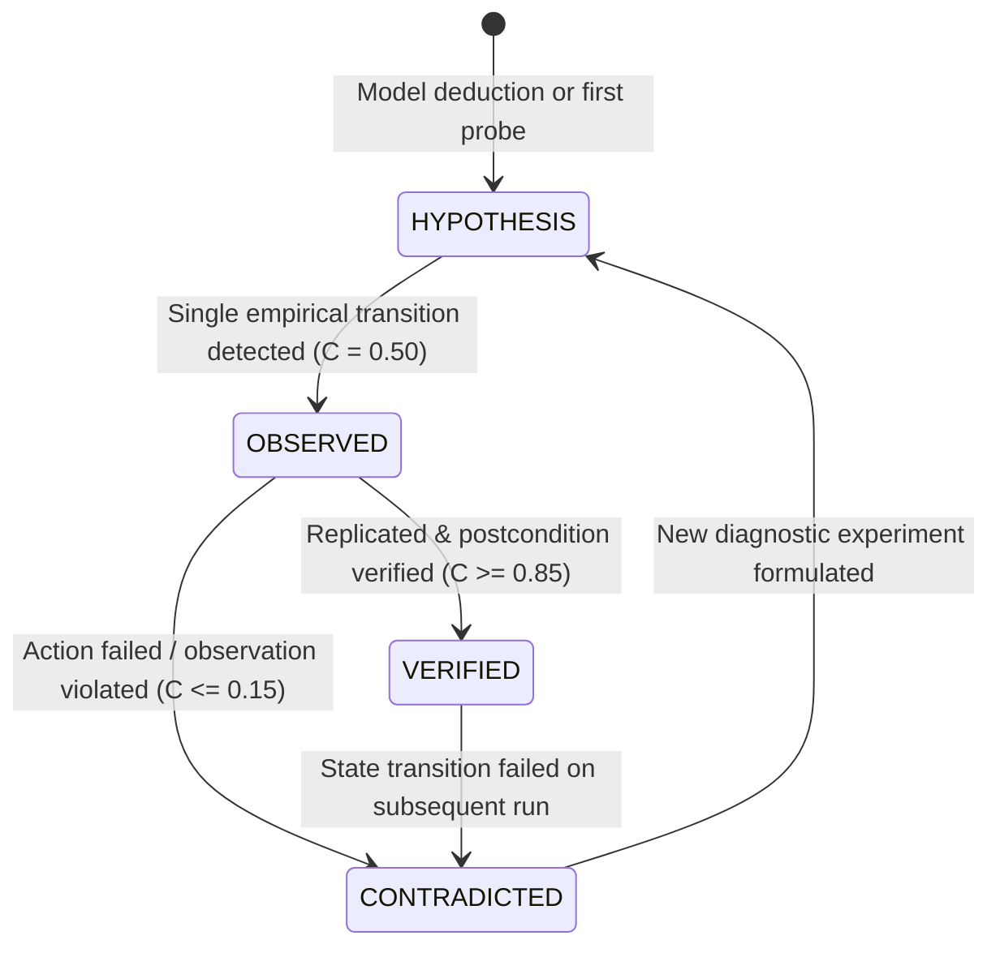
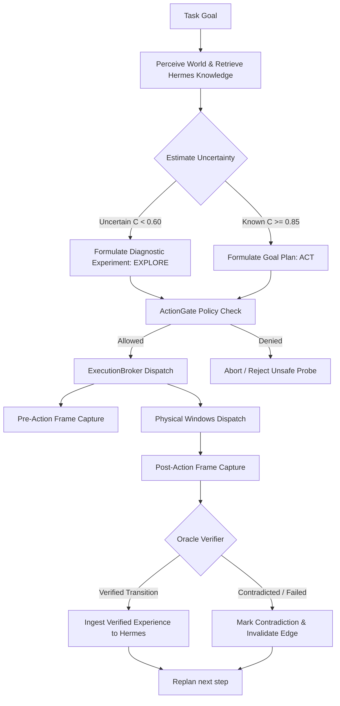

# Hermes Experiential Memory & Autonomous Exploration Architecture

## 1. Executive Summary

AstraRun's Computer Use subsystem previously operated in a deterministic *Plan -> Execute -> Verify* mode. When encountering an application with unexpected UI structures, unusual controls (e.g. Scintilla editing surfaces, custom tab bars, non-standard dialog buttons), or uncataloged hotkeys, static planning either succeeded by chance or failed when hardcoded heuristics missed.

**Hermes** transforms AstraRun into an **empirical, experiential learning agent**:
1. **Perceive & Anchor**: On encountering a desktop scenario, Astra extracts structured UI entities and hashes the application environment.
2. **Retrieve Prior Experience**: Queries the local Hermes SQLite knowledge graph for known affordances, verified control paths, and state transitions for this entity.
3. **Uncertainty Quantification**: Calculates an epistemic confidence score for the candidate goal actions ($C \in [0.0, 1.0]$). Classifies confidence into states:
   - `KNOWN` ($C \ge 0.85$): Directly dispatch governed `ACT`.
   - `LIKELY` ($0.60 \le C < 0.85$): Dispatch `ACT` with heightened postcondition surveillance.
   - `UNCERTAIN` ($0.30 \le C < 0.60$): Enter `EXPLORE` mode; formulate bounded diagnostic experiment.
   - `UNKNOWN` ($C < 0.30$): Cold-encounter; enter `EXPLORE` mode; run non-destructive discovery probe.
   - `CONTRADICTED` ($C \le 0.15$): An invalid prior belief was disproved; invalidate edges, formulate corrective experiment.
4. **Autonomous Experimentation**: Under `EXPLORE` mode, the agent devises a *safe, bounded diagnostic experiment* (e.g. focus window, inspect UIA control tree, send benign discovery key or click harmless target, observe state change).
5. **Causal Ingestion**: Action execution is governed strictly by `ActionGate` and `ExecutionBroker`. Pre- and post-observations are captured via `ComputerUseObservationFrame`. Only **verified state transitions** are ingested into Hermes.
6. **Experience Reuse**: Subsequent tasks in the same application retrieve verified nodes and execute with low latency and zero exploratory probes.

---

## 2. Experiential Knowledge Graph Ontology

Hermes represents application knowledge as an attributed directed multi-graph stored in SQLite with full text search (FTS5):

### 2.1 Graph Node Types
1. **Entity**:
   - `APPLICATION`: Desktop process (binary name, executable SHA-256 hash, product version).
   - `WINDOW`: Top-level or popup window (window class, title pattern, role).
   - `CONTROL`: UI element (control type, class name, surface area rank, automation ID).
2. **Affordance**:
   - Capabilities supported by an entity (e.g., `text_input`, `document_save`, `tab_new`, `dialog_dismiss`, `menu_invoke`).
   - Includes parameter expectations and risk classification.
3. **State Transition**:
   - A causal edge: $\text{State}_{\text{pre}} \xrightarrow{\text{Action}} \text{State}_{\text{post}}$.
   - Records precondition predicate, action name, action payload, postcondition predicate, and observed delta.
4. **Diagnostic Experiment**:
   - Hypothesis tested by the agent.
   - Bounded probe action dispatched.
   - Expected vs observed observation delta.
   - Verification status: `CONFIRMED`, `REFUTED`, `INCONCLUSIVE`.

---

## 3. Epistemic Confidence & Fallibility Lifecycle

Knowledge nodes transition through four strict epistemic states:

### Bayesian Evidence Updating
- **Initial Prior**: $P(H) = 0.20$ (Cold Start / Hypothesis).
- **Affirmative Verification**: $C_{t+1} = \min(1.0, C_t + 0.35 \times (1 - C_t))$.
- **Contradiction / Failure**: $C_{t+1} = \max(0.05, C_t \times 0.20)$.
- **Temporal Decay**: Half-life decay applies if environment hash changes or 30 days elapse without reinforcement: $C_{t} = C_0 \times e^{-\lambda \Delta t}$.

---

## 4. The Governed Exploration Loop

---

## 5. Architectural Boundaries & Invariants

1. **No Production Brand Hacks**: The learning architecture is generic across all Windows executables. Zero `if app == "notepad++": ...` shortcuts in production code or Hermes base memory.
2. **ActionGate Supremacy**: Diagnostic exploration actions have bounded risk ceilings. Destructive actions (`DELETE`, `OVERWRITE`, `KILL_PROCESS`) are strictly forbidden during exploration.
3. **Task-Scoped Resource Cleanup**: Any application launched during exploration or test probing is registered in `AstraResourceLedger` and cleanly terminated upon session completion.
4. **Causal Traceability**: Every knowledge entry in Hermes carries cryptographic hashes of the generating prompt, model response, trace ID, pre-action frame ID, and post-action frame ID.
